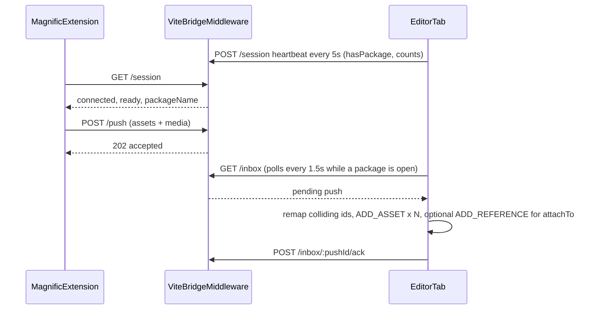

# Editor extension bridge (dev-only)

The DAICE-Chain editor's Vite dev server exposes a small HTTP API so the Magnific
Chrome extension can check whether an editor tab is open and push one or more DAICE-Chain assets —
with media and pre-wired reference relationships — straight into the
package the user currently has open.

**This bridge only exists while `npm run dev` is running.** It is registered
as a Vite plugin (`vite-plugins/daiceExtensionBridge.ts`) via
`configureServer`, which Vite never invokes during `vite build` / `vite
preview`. There is no equivalent in a production build; the extension's
file-download flow remains the primary, always-available handoff path, and
this API is an optional live shortcut for local development.

Default dev URL: `http://localhost:5173` (the port is whatever `npm run dev`
prints — Vite picks the next free port starting at 5173, so check the
terminal output rather than assuming).

Base path: **`/api/daice-editor/v1`**, permissive CORS
(`Access-Control-Allow-Origin: *`) so a Chrome extension's background script
can call it directly.

## Flow



1. `GET /health` — confirm the bridge is up at all.
2. `GET /session` in a loop until `ready: true` — the user needs to have a
   package open in the editor tab (Home screen doesn't count).
3. `POST /push` with one or more assets.
4. The editor tab applies the push on its next poll tick (undoable with
   Ctrl+Z like any other edit) and shows a toast.

## Endpoints

| Method | Path | Caller | Purpose |
|--------|------|--------|---------|
| `GET` | `/health` | Extension | Bridge is up: `{ ok: true, service, version }` |
| `GET` | `/session` | Extension | Is an editor tab connected and ready? |
| `POST` | `/session` | Editor tab | Heartbeat (internal — the extension never calls this) |
| `POST` | `/push` | Extension | Queue asset(s) for import |
| `GET` | `/inbox` | Editor tab | Poll pending pushes (internal) |
| `GET` | `/inbox/:pushId/media/:assetId` | Editor tab | Fetch one push's raw media bytes (internal) |
| `POST` | `/inbox/:pushId/ack` | Editor tab | Remove an applied/failed push (internal) |

Only `/health`, `/session` (GET), and `/push` matter to the extension; the
rest exist purely for the editor tab to pull its own queue and are
documented here for completeness.

### `GET /session`

```json
{
  "connected": true,
  "ready": true,
  "sessionId": "session-...",
  "hasPackage": true,
  "packageId": "pkg-...",
  "packageName": "Demo shoot",
  "assetCount": 12,
  "lastSeenAt": 1735500000000
}
```

- `connected` is true only if a heartbeat arrived from an editor tab within
  the last 15 seconds.
- `ready` is true only if `connected` **and** `hasPackage` — i.e. the user
  is on the editor screen with a package open, not the Home screen.
- If multiple editor tabs are open, the most recently-heartbeating one wins.

### `POST /push`

Returns **409** if not `ready` ("open a package in the editor first").

Request body — references may already link assets within the same batch,
so you can push a whole lineage chain (e.g. a generated image plus the
upscale derived from it) in one call:

```ts
interface ExtensionPushBody {
  /** One or more spec-shaped assets (see spec/README.md); references[] may link assets within this same batch by their `id`. */
  assets: DaiceAsset[];
  /** Optional: after import, link an existing package asset (by id) to every pushed root — an asset in this batch that nothing else in the batch references. */
  attachTo?: string;
  /** Per-asset media, keyed by the asset id used in `assets`. One entry per asset that has a file — `url` is optional if you're instead sending the bytes as a `media_<assetId>` multipart part (see "Transport" below); a multipart part is used in preference to `url` when both are present. */
  media?: Array<{
    assetId: string;
    /** Remote URL — the bridge fetches it server-side, avoiding browser CORS on whatever CDN Magnific serves from. */
    url?: string;
    filename?: string;
    mimeType?: string;
  }>;
}
```

`DaiceAsset` (from [`@leoninestudios/daice-chain-core`](../packages/core/src/types.ts) /
[`spec/README.md`](../spec/README.md)):

```ts
interface DaiceAsset {
  id: string;
  aiGenerated: boolean;
  provider?: string;
  model?: string;
  prompt?: string;
  generatedBy?: { name: string; email?: string };
  generatedAt?: string;
  seed?: number;
  mediaPath?: string;
  mediaMimeType?: string;
  references: Array<{ assetId: string; label?: string }>;
  timecodeIn?: string;
  timecodeOut?: string;
  metadata?: Record<string, unknown>;
}
```

`references` may be omitted; the bridge treats a missing array as `[]`
rather than rejecting the push. Every other field is validated against
`@leoninestudios/daice-chain-core`'s `assetSchema` — an invalid asset gets a **422** with
path-scoped errors, e.g.:

```json
{
  "error": "One or more assets failed validation.",
  "errors": [{ "path": "assets[0].seed", "message": "Expected integer, received float" }]
}
```

**Transport — either works:**

1. **`application/json`** — metadata plus `media[].url`; the bridge
   downloads the file itself.
2. **`multipart/form-data`** — a `payload` field containing the same JSON
   body as a string (still list the asset in `media` with its `assetId`,
   just omit `url`), plus one `media_<assetId>` file part per asset that
   already has bytes on hand (skips the extra round-trip through a URL).

Success response — **202**:

```json
{ "accepted": true, "pushId": "..." }
```

### What happens once accepted

- Any pushed asset `id` that collides with one already in the open package
  is remapped (`<id>-copy`, or `<id>-copy-<suffix>` on further collision),
  and the remap is propagated through `references` inside the same batch —
  you never need to pre-check the open package's ids yourself.
- Media is turned into a `File` exactly as if the user had dropped it onto
  that row, so it goes through the same pending-file/export path as any
  other asset.
- If `attachTo` is set and matches an existing asset id in the package, that
  asset gets a new reference to each pushed root; assets pushed only to
  reference each other (not `attachTo`) still land in the package as
  independent roots.
- The apply goes through the same `ADD_ASSET`/`ADD_REFERENCE` dispatches as
  any other edit, so it's undoable with Ctrl+Z — one dispatch (one pushed
  asset, or one `attachTo` link) per undo step, same as duplicating a row.

## Trying it with curl

```bash
curl http://localhost:5173/api/daice-editor/v1/health

curl http://localhost:5173/api/daice-editor/v1/session

curl -X POST http://localhost:5173/api/daice-editor/v1/push \
  -H "Content-Type: application/json" \
  -d '{
    "assets": [
      {
        "id": "hero-shot",
        "aiGenerated": true,
        "provider": "Midjourney",
        "model": "v6",
        "prompt": "a lighthouse at dusk",
        "seed": 42,
        "references": []
      }
    ]
  }'
```
